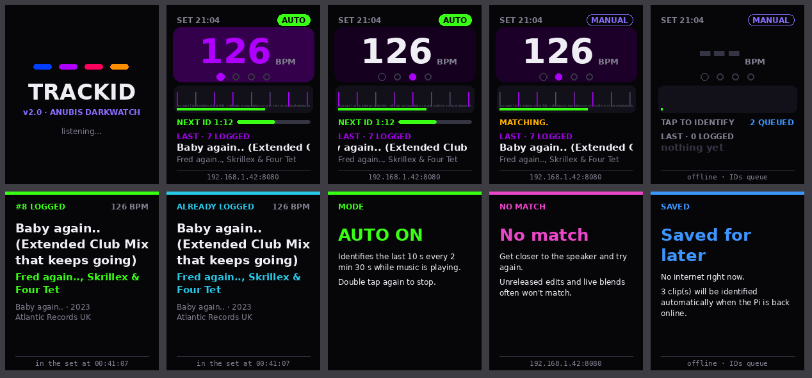
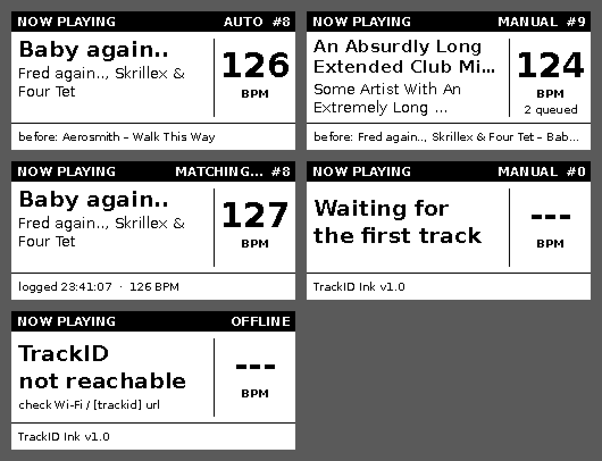

# TrackID

Always-listening **track ID + setlist logger** for DJs, on a Raspberry Pi Zero 2W with the PiSugar Whisplay HAT.
Point it at the speaker and it logs every track into a timestamped setlist, ready to paste into YouTube chapters
or Mixcloud. It also shows the live BPM.

| TrackID (Whisplay HAT) | TrackID Ink (e-paper sign) |
|---|---|
|  |  |

## What's in here
| Folder | What it is |
|---|---|
| [`trackid/`](trackid/) | **TrackID v2.2.** Tap to ID the last 10 s, AUTO mode that IDs each new track, your own offline fingerprint library, live BPM, offline queue, editable web setlist with Tracklist / YouTube chapters / Mixcloud / CSV exports. |
| [`trackid-ink/`](trackid-ink/) | **TrackID Ink.** A now-playing sign on a second Pi with a 2.13" e-paper (Waveshare HAT V4 or Adafruit bonnet). Reads TrackID over Wi-Fi. |
| [`windows/`](windows/) | Double-click installers for Windows. They SSH into the Pi and set everything up. |

## Quick start
1. Flash **Raspberry Pi OS Lite** with Raspberry Pi Imager (64-bit for the Zero 2W). In its settings, set a hostname
   (`trackid`), user, Wi-Fi (2.4 GHz) and turn on SSH.
2. Get an AudD API token at dashboard.audd.io.
3. Install it, either way:
   - **Windows:** download [`windows/Install-TrackID.bat`](windows/Install-TrackID.bat) and double-click it.
   - **Any computer:** `ssh <user>@trackid.local`, then
     ```
     sudo apt-get install -y git
     git clone https://github.com/anubisdarkwatch/TrackID.git && cd TrackID/trackid
     sudo bash install.sh
     ```
4. Open `http://trackid.local:8080` for your tracklists.

Updating later: `cd ~/TrackID && git pull`, then `sudo systemctl restart trackid` (or re-run the Windows installer).

Full details: [`trackid/README.md`](trackid/README.md) and [`trackid-ink/README.md`](trackid-ink/README.md).

## Notes
- AudD matches released recordings. For your own edits and unreleased tracks, add them to the local library
  (`trackid/library/`): they match offline and cost nothing. Anything still unknown is logged as `ID - ID` for you to fill in.
- AUTO listens for track changes and makes about one AudD request per new track (capped per hour), so check your plan's quota.
- The BPM uses the same beat engine as [Beat Commander](https://github.com/anubisdarkwatch/Beat-Commander).

Built by Anubis Darkwatch with Claude. Code MIT (see `LICENSE`). The Waveshare driver files in `trackid-ink/waveshare_epd/`
keep their own MIT-style notice.
