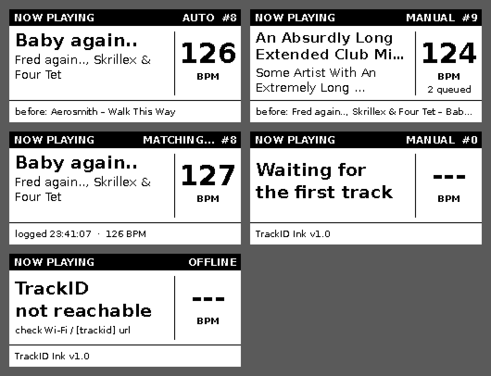

# TrackID Ink: e-paper now-playing sign

A second Pi with a 2.13" e-paper shows what TrackID is playing. Three boards are supported:
the **Waveshare 2.13" e-Paper HAT V4**, the **Waveshare 2.13" Touch e-Paper HAT** (with or without its case) and the
**Adafruit 2.13" Monochrome E-Ink Bonnet (#4687)**. It shows
track, artist, BPM, AUTO/MANUAL, track count and the previous track. It stays readable in daylight, uses almost
no power, and keeps the last picture even if it loses power.



## Touch e-Paper HAT: a remote for TrackID
With the Waveshare **Touch** e-Paper HAT the sign doubles as a remote, so you can work TrackID from across the booth:

| Gesture | Result |
|---|---|
| Tap anywhere | Identify now (same as tapping TrackID's button) |
| Hold 1 s | AUTO on / off |
| Swipe sideways | Flip between **Now Playing** and **This set** (the last 5 tracks with their start times) |

A black strip along the bottom confirms each touch (**IDENTIFYING…**, **AUTO ON**, …), and the result shows up as
soon as TrackID has it. The recent-tracks page goes back to Now Playing after 30 s.

It needs TrackID v2.2 or later with `[web] remote = true` (the default). Set `remote = false` there to make TrackID
ignore it. The touch chip (GT1151) is on I2C. The installer switches I2C on when you pick the Touch HAT.


## Why a second Pi?
Neither e-paper board can share a Pi with the Whisplay. They all use the same SPI chip-select, and the e-paper's
control pins land on the Whisplay's button, its LED and (Waveshare) the audio clock. So TrackID Ink runs on its own Pi
(a **Zero W / WH** is plenty) and asks TrackID over Wi-Fi what's playing. Both Pis must be on the same network.

## How it updates
- Every 2 s it reads `http://trackid.local:8080/api/state`. It redraws only when something on screen changes.
- **Waveshare:** quick partial updates (~0.3 s, no flash). After 30 updates, or every 15 minutes, it does one full
  refresh, the black/white flash that clears ghosting.
- **Adafruit:** Adafruit's driver only does full refreshes (~2–3 s, with a flash), so BPM-only changes are held to
  once every 20 s or more. New tracks still show right away.
- The BPM only changes when it moves by a whole beat, and at most every 6 s, so it doesn't flicker all set long.
- The panel stays awake while updates keep coming and sleeps after a quiet minute. If TrackID drops off the network for a few polls, it shows **OFFLINE**.
- No beat flashing: e-paper is too slow for that. That's the Whisplay's job.

## Install
1. Flash **Raspberry Pi OS Lite** with Raspberry Pi Imager (32-bit for a Zero W/WH). Set a hostname (e.g. `trackid-ink`),
   user, the **same Wi-Fi as TrackID**, and SSH.
2. Seat the board on the 40-pin header. Waveshare: leave the **BS** switch/jumper at **0** (4-line SPI).
   Touch HAT with case: put the Pi into the case first, then press the screen on. It takes a little wiggling
   before it drops onto the pins.
3. On the Pi (`ssh <user>@trackid-ink.local`):
```
sudo apt-get install -y git
git clone https://github.com/anubisdarkwatch/TrackID.git && cd TrackID/trackid-ink
sudo bash install.sh          # asks Waveshare, Waveshare Touch or Adafruit (and V4/V3/V2 for Waveshare)
sudo reboot                   # first time only (turns SPI on)
```
On Windows you can double-click [`../windows/Install-TrackID-Ink.bat`](../windows/Install-TrackID-Ink.bat) instead.

If `trackid.local` doesn't resolve on your network (some phone hotspots block it), put TrackID's IP in
`config.ini` (`[trackid] url = http://<ip>:8080`), then `sudo systemctl restart trackid-ink`.

## Config (`config.ini`)
| Key | Default | Notes |
|---|---|---|
| trackid.url | http://trackid.local:8080 | where TrackID is |
| trackid.poll | 2 | seconds between checks |
| display.bpm_step / bpm_min_gap | 1 / 6 | how much the BPM must move, and how often it may redraw |
| display.full_refresh_every / full_refresh_minutes | 30 / 15 | full clean refresh cadence |
| display.panel | waveshare | or `adafruit` (the installer sets it) |
| display.waveshare_model | V4 | Waveshare panel generation: `V4`, `V3` or `V2` (see below) |
| display.adafruit_driver | ssd1680b | Adafruit only: if the picture is garbled or shifted, try `ssd1680`, then `ssd1680_legacy`, then `ssd1675b` |
| display.flip | false | rotate 180° (touch follows it) |
| touch.enabled | false | Touch e-Paper HAT: use the screen as a TrackID remote (the installer sets it) |
| touch.hold_s / list_timeout | 1.0 / 30 | hold time for AUTO on/off; seconds before the list page goes back |

## Troubleshooting
- Logs: `journalctl -u trackid-ink -f`
- Blank or frozen: check `ls /dev/spidev0.0` exists (SPI on), and that the screen's ribbon is fully clicked into the
  HAT's connector (contacts facing the board, latch closed).
- **Waveshare: garbled, half-drawn, or the panel never changes?** The *panel* generation matters, not the sticker on the
  HAT. Set `waveshare_model` to `V4`, then `V3`, then `V2` (restart after each). Panels with an **FPC-A002** ribbon
  dated 2019-2021 are usually **V2**.
  Adafruit: try the other `adafruit_driver` values. Bonnets made over the years use different panels.
- **Touch does nothing:** the log says `touch screen not found` if the chip didn't answer. Check `ls /dev/i2c-1`
  (I2C on; reboot after installing), then `sudo i2cdetect -y 1` should show **14**. If touches register but TrackID says
  *remote control is turned off*, set `[web] remote = true` in TrackID's `config.ini`.
- **Touch HAT picture garbled?** Same fix as above: try `waveshare_model` `V4`, then `V3`, then `V2`.
- Shows OFFLINE: open `http://trackid.local:8080/api/state` from the ink Pi (`curl …`). If that fails, use the IP.
- Preview the screens on any computer: `python3 ink.py --preview out/`

Waveshare driver files in `waveshare_epd/` are copied unchanged from waveshareteam/e-Paper (MIT-style licence, see
each file's header).
